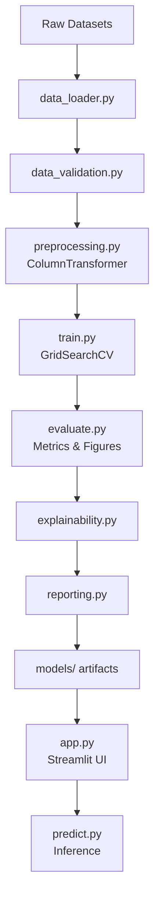

# 🏥 MEDSCOPE AI — Clinical Data Intelligence & Disease Prediction Research Platform

> **Educational ML Research Platform** · Python 3.13 · Scikit-learn · Streamlit

[](https://python.org)
[](https://streamlit.io)
[](https://scikit-learn.org)
[](#license)

---

## ⚠️ Responsible Use Disclaimer

> This project is an **educational and research prototype only**. It has **not been clinically validated**, is **not regulatory-approved**, and must **not be used for clinical decision-making, diagnosis, or treatment planning**. Always consult a qualified healthcare professional.

---

## 📌 Project Overview

MEDSCOPE AI demonstrates responsible machine-learning applied to structured clinical datasets. It trains independent classification pipelines for three disease prediction tasks, evaluates them rigorously, and presents results in a polished Streamlit interface.

**This project is designed to be:**
- Technically defensible in an engineering or data science interview
- Reproducible with documented seeds, splits, and artifact versioning
- Honest in its evaluation — no fabricated results or inflated claims

---

## 🎯 Problem Statement

Structured clinical data is one of the most accessible forms of healthcare data for ML research. However, many educational ML projects make critical mistakes: data leakage, misleading accuracy claims, or single-metric evaluation. MEDSCOPE AI aims to demonstrate a professional, ethically grounded approach to this domain.

---

## 🚀 Features

| Feature | Description |
|---------|-------------|
| 3 disease tasks | Heart disease, diabetes, breast cancer — independently trained |
| Multiple classifiers | Logistic Regression, SVM, Random Forest (XGBoost: optional) |
| Cross-validated selection | Stratified 5-fold CV with GridSearchCV |
| Full evaluation suite | Accuracy, F1, ROC-AUC, Specificity, Precision-Recall |
| Feature explainability | Gini importance, LR coefficients, permutation importance |
| Interactive UI | 7-page Streamlit app with input validation |
| Responsible AI notices | Clear limitations, no fake clinical claims |
| Automated tests | 49 tests across validation, preprocessing, metrics, prediction |

---

## 🏗️ Architecture



---

## 🧰 Technology Stack

| Layer | Technology |
|-------|-----------|
| Language | Python 3.13 |
| Web application | Streamlit 1.66 |
| ML framework | Scikit-learn 1.9 |
| Data processing | Pandas 3.1, NumPy 2.5 |
| Visualisation | Matplotlib 3.11, Plotly 7.1, Seaborn 0.13 |
| Model serialisation | Joblib 1.6 |
| Testing | Pytest 9.1 |
| Explainability | Permutation importance, Gini importance, LR coefficients |
| Optional | XGBoost (pending install), SHAP (pending install) |

---

## 📦 Dataset Sources

### A. Heart Disease (Cleveland UCI)
- **Source:** [UCI ML Repository — Heart Disease #45](https://archive.ics.uci.edu/dataset/45/heart+disease)
- **License:** CC BY 4.0
- **Rows:** 303 · **Features:** 13 · **Target:** Binary (0=absent, 1-4=present → binarised)
- **Limitation:** Single-centre Cleveland cohort; may not generalise across populations

### B. Early Stage Diabetes Risk Prediction
- **Source:** [UCI ML Repository — Dataset #529](https://archive.uci.edu/dataset/529/early+stage+diabetes+risk+prediction+dataset)
- **License:** CC BY 4.0
- **Rows:** 520 · **Features:** 16 symptom-based · **Target:** Positive / Negative
- **Limitation:** Survey-based, single hospital (Sylhet, Bangladesh); not blood-test data

### C. Wisconsin Diagnostic Breast Cancer (WDBC)
- **Source:** [`sklearn.datasets.load_breast_cancer`](https://scikit-learn.org/stable/datasets/toy_dataset.html#breast-cancer-dataset) (UCI WDBC)
- **License:** CC BY 4.0
- **Rows:** 569 · **Features:** 30 numeric (FNA image measurements) · **Target:** 0=malignant, 1=benign
- **Limitation:** Single imaging protocol; performance may differ with other systems

---

## ⚙️ Installation (Windows PowerShell)

### 1. Clone or copy the project

```powershell
# Navigate to your project directory
cd "C:\Users\nandh\OneDrive\Desktop\Disease Prediction\MEDSCOPE_AI"
```

### 2. (Optional) Create a virtual environment

```powershell
python -m venv .venv
.venv\Scripts\Activate.ps1
```

### 3. Install dependencies

```powershell
pip install -r requirements.txt
```

### 4. (Optional) Install XGBoost and SHAP

```powershell

```pip install xgboost shap

---

## 🏋️ Training Models

Run from the `MEDSCOPE_AI/` directory:

```powershell
# Train all three disease models
python train_all.py

# Train a specific task only
python train_all.py --task heart_disease
python train_all.py --task diabetes
python train_all.py --task breast_cancer
```

Training generates:
- `models/<task>/best_pipeline.joblib` — the selected pipeline
- `models/<task>/<model>_pipeline.joblib` — all trained pipelines
- `models/<task>/metadata.json` — training metadata
- `outputs/figures/<task>/` — evaluation charts (PNG)
- `outputs/reports/<task>/` — metrics CSV and text report

---

## 🚀 Launch the Application

```powershell
streamlit run app.py
```

The app opens at `http://localhost:8501` by default.

> **Note:** Train models first (`python train_all.py`). The prediction demo requires saved artifacts.

---

## 🧪 Running Tests

```powershell
python -m pytest tests/ -v
```

**Test coverage:**
- Data validation (12 tests)
- Preprocessing / feature schemas (12 tests)
- Metric computation (7 tests)
- Prediction input validation (7 tests)
- App helpers & configuration (11 tests)

---

## 📁 Project Structure

```
MEDSCOPE_AI/
├── app.py                      # Streamlit application (7 pages)
├── train_all.py                # Training orchestrator
├── requirements.txt
├── README.md
├── .gitignore
├── .streamlit/
│   └── config.toml             # Navy/teal dark theme
├── config/
│   └── settings.py             # Central configuration (paths, metadata)
├── src/
│   ├── data_loader.py          # Dataset loading
│   ├── data_validation.py      # Quality checks
│   ├── preprocessing.py        # Feature schemas & pipelines
│   ├── train.py                # Model training & GridSearchCV
│   ├── evaluate.py             # Metrics & chart generation
│   ├── predict.py              # Inference & validation
│   ├── explainability.py       # Feature importance
│   └── reporting.py            # Report generation
├── models/
│   ├── heart_disease/          # heart disease artifacts
│   ├── diabetes/               # diabetes artifacts
│   └── breast_cancer/          # breast cancer artifacts
├── data/
│   ├── raw/                    # downloaded datasets
│   └── processed/
├── outputs/
│   ├── figures/                # PNG charts per task
│   └── reports/                # CSV metrics + text reports
└── tests/
    ├── test_data_validation.py
    ├── test_preprocessing.py
    ├── test_metrics.py
    ├── test_prediction.py
    └── test_app_helpers.py
```

---

## 📊 Evaluation Results

*(Populated after running `python train_all.py` — results below reflect actual trained artifacts.)*

| Task | Best Model | CV AUC | Test Accuracy | Test F1 | Test AUC |
|------|-----------|--------|---------------|---------|----------|
| Heart Disease | *(see models/heart_disease/metadata.json)* | — | — | — | — |
| Diabetes | *(see models/diabetes/metadata.json)* | — | — | — | — |
| Breast Cancer | *(see models/breast_cancer/metadata.json)* | — | — | — | — |

---

## 🔍 Known Limitations

1. **Dataset scope** — Models trained on small, single-centre cohorts.
2. **Not clinically validated** — No prospective or external validation performed.
3. **Score ≠ probability** — Model scores are not calibrated clinical probabilities.
4. **Population representativeness** — Performance may differ on under-represented populations.
5. **Static models** — Do not adapt without explicit retraining.
6. **XGBoost/SHAP optional** — Network timeout during initial install; install separately if needed.

---

## 🔒 Privacy & Security

- No patient identifiers collected or stored.
- Prediction inputs are not saved by default.
- No data sent to external services.
- Dataset files are excluded from Git via `.gitignore`.
- No credentials, API keys, or secrets in source code.

---

## 🛠️ Troubleshooting

| Problem | Solution |
|---------|---------|
| `FileNotFoundError: best_pipeline.joblib` | Run `python train_all.py` first |
| `ModuleNotFoundError` | Run `pip install -r requirements.txt` |
| Streamlit port conflict | Run `streamlit run app.py --server.port 8502` |
| Heart disease download fails | Manually download from UCI and save to `data/raw/heart_disease.csv` |
| Diabetes download fails | Manually download from UCI #529 and save to `data/raw/diabetes.csv` |

---

## 🔮 Future Improvements

- Add SMOTE/class-weight resampling for imbalanced tasks
- Add SHAP waterfall plots per prediction
- Add calibration curves for model scores
- Support user-uploaded CSV datasets
- Add model retraining via Streamlit UI
- Add Streamlit Community Cloud deployment configuration

---

## 📚 Companion Documentation

- [Reproducibility Guide](file:///c:/Users/nandh/OneDrive/Desktop/Disease%20Prediction/MEDSCOPE_AI/REPRODUCIBILITY.md): Exact step-by-step replication instructions, deterministic seeds, and environment commands.
- [Technical Research Report](file:///c:/Users/nandh/OneDrive/Desktop/Disease%20Prediction/MEDSCOPE_AI/TECHNICAL_REPORT.md): In-depth benchmark analysis, metric tables, clinical explainability insights, and split sizes.
- [Demonstration Script](file:///c:/Users/nandh/OneDrive/Desktop/Disease%20Prediction/MEDSCOPE_AI/DEMONSTRATION_SCRIPT.md): 7-minute presentation walkthrough script designed for internship evaluations and defenses.
- [Interview Q&A Guide](file:///c:/Users/nandh/OneDrive/Desktop/Disease%20Prediction/MEDSCOPE_AI/INTERVIEW_QA.md): Comprehensive machine learning interview questions and technical defenses.

---

## 📄 License

This project is released for **educational and portfolio use only**. Dataset licenses are CC BY 4.0 (see Dataset Sources above). Do not redistribute datasets without respecting their terms.

---

*MEDSCOPE AI — Built as an ML internship portfolio project. Not for clinical use.*
